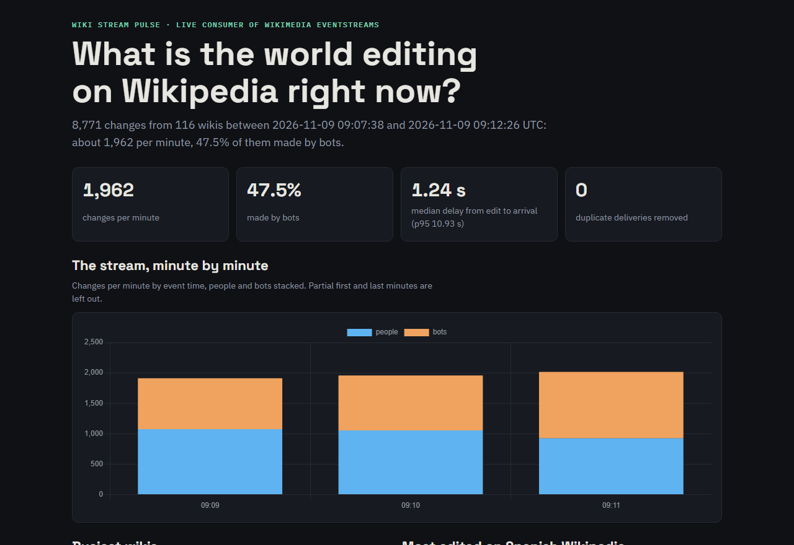
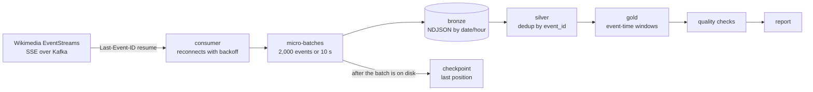

# Wiki Stream Pulse

[](https://github.com/jonathantorresdata/wiki-stream-pulse/actions/workflows/ci.yml)

**What is the world editing on Wikipedia right now?** A streaming pipeline that consumes the live Wikimedia event stream (about 2,000 changes per minute from 100+ wikis), lands it in micro-batches, deduplicates it, aggregates it in event-time windows and publishes a report. Built to practise the core ideas of streaming without a cluster: offsets and checkpoints, at-least-once delivery, idempotent processing, event time vs processing time.

**Live report:** https://jonathantorresdata.github.io/wiki-stream-pulse/ (a 10-minute snapshot, refreshed daily)



## How it works



## The streaming ideas, and how they are proven

| Idea | Implementation | Evidence |
|---|---|---|
| **Resume after a stop** | Each event carries its Kafka position in the SSE `id`; after every batch it is saved and sent back as `Last-Event-ID` on restart. | Stopped the consumer for ~25 s and resumed: no 10-second window of event time is empty, and the first minute read ~3,400 events (catching up) instead of ~2,400. |
| **At-least-once + idempotency** | Write the batch, then commit the checkpoint; silver keeps one row per `event_id`. | Unit test: the last batch delivered twice → 40 rows in bronze, 30 events in silver. |
| **Micro-batches** | Flush every 2,000 events or 10 s, atomic writes, `date=/hour=` folders. | At most 10 s of data can be replayed after a crash. |
| **Event time vs processing time** | Windows on the edit's own timestamp; delay = arrival − edit. | Median delay 1.2 s, 95th percentile 11 s. |
| **Quality gate** | Unique ids, no events from the future, windows that add up, required fields. | The "future events" check caught a time-zone bug: every timestamp was off by exactly one hour on a machine in UTC+1. Fixed by pinning DuckDB sessions to UTC ([ADR 0004](docs/adr/0004-event-time-and-utc.md)). |

## Run it

Requirements: Python 3.11+.

```bash
git clone https://github.com/jonathantorresdata/wiki-stream-pulse.git
cd wiki-stream-pulse
python3 -m venv .venv && source .venv/bin/activate
pip install -r requirements.txt

python scripts/run.py --minutes 3     # consume 3 minutes, build, check, report (site/index.html)
python scripts/run.py --minutes 1     # stop and run again: it resumes from the checkpoint
python scripts/run.py --minutes 0     # rebuild models and report from bronze only
python -m pytest -q                   # parser, batching, checkpoint and deduplication tests
```

## Structure

```
wikistream/
  sse.py         Server-Sent Events parser and client (resume + backoff)
  sink.py        checkpoint, event slimming, atomic micro-batch writer
  collect.py     the consumer loop: batch, flush, commit
  transform.py   bronze → silver → gold in DuckDB, and the quality checks
  report.py      static report
scripts/run.py   consume → transform → check → report, exit code 1 on a failed check
tests/           unit tests on a recorded sample of the real stream
docs/adr/        architecture decision records
```

Decisions: [docs/adr](docs/adr/). Data: [Wikimedia EventStreams](https://stream.wikimedia.org/) (CC BY-SA).
